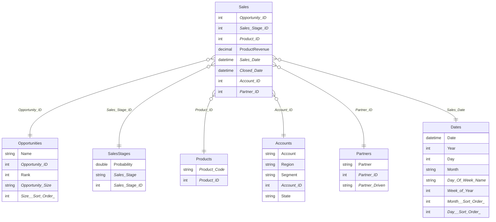

# Power BI Ingest

A CLI tool to extract schema and measures from Power BI PBIP projects. It parses `.tmdl` files from the project's Semantic Model and outputs either a Mermaid ERD or formatted DAX measure expressions.

## Requirements

- A Power BI project saved in [PBIP format](https://learn.microsoft.com/en-us/power-bi/developer/projects/projects-overview) (`.pbip`)

## Usage

```
pbingest <PROJECT_PATH> [--table] [--measure] [--output <FILE>]
```

| Argument | Description |
|---|---|
| `PROJECT_PATH` | Path to the PBIP project folder (must contain a `.SemanticModel` subfolder) |
| `--table` | Extract all tables with columns and data types, and render relationships as a Mermaid ERD. This is the **default** when no option is specified. |
| `--measure` | Extract all DAX measure expressions, grouped by table. |
| `--output FILE` | Write output to a file instead of stdout. |

Both `--table` and `--measure` can be combined in a single run.

## Examples

- Open the `Revenue Opportunities.pbix` file and save it in PBIP format in the `/pbi_sample_project` directory.

```bash
# Generate ERD diagram (default)
pbingest ./pbi_sample_project

# Generate ERD and save to file
pbingest ./pbi_sample_project --table --output erd.md

# Export all DAX measures
pbingest ./pbi_sample_project --measure --output measures.md

# Generate both ERD and measures in one file
pbingest ./pbi_sample_project --table --measure --output output.md
```

---

## Sample Output

### `--table` — Mermaid ERD

Generated from `pbi_sample_project` (Revenue Opportunities):



### `--measure` — DAX Measures

Generated from `pbi_sample_project` (Revenue Opportunities):

```
Sales.'Average Revenue'
AVERAGE([ProductRevenue])

Sales.'Total Opportunity Count'
COUNTA([Opportunity ID])

Sales.'Total Revenue'
SUM([ProductRevenue])

Sales.'Average Opportunity Days'
AVERAGEX(
    Sales,
    DATEDIFF(Sales[Sales Date], Sales[Closed Date], DAY)
)
```


